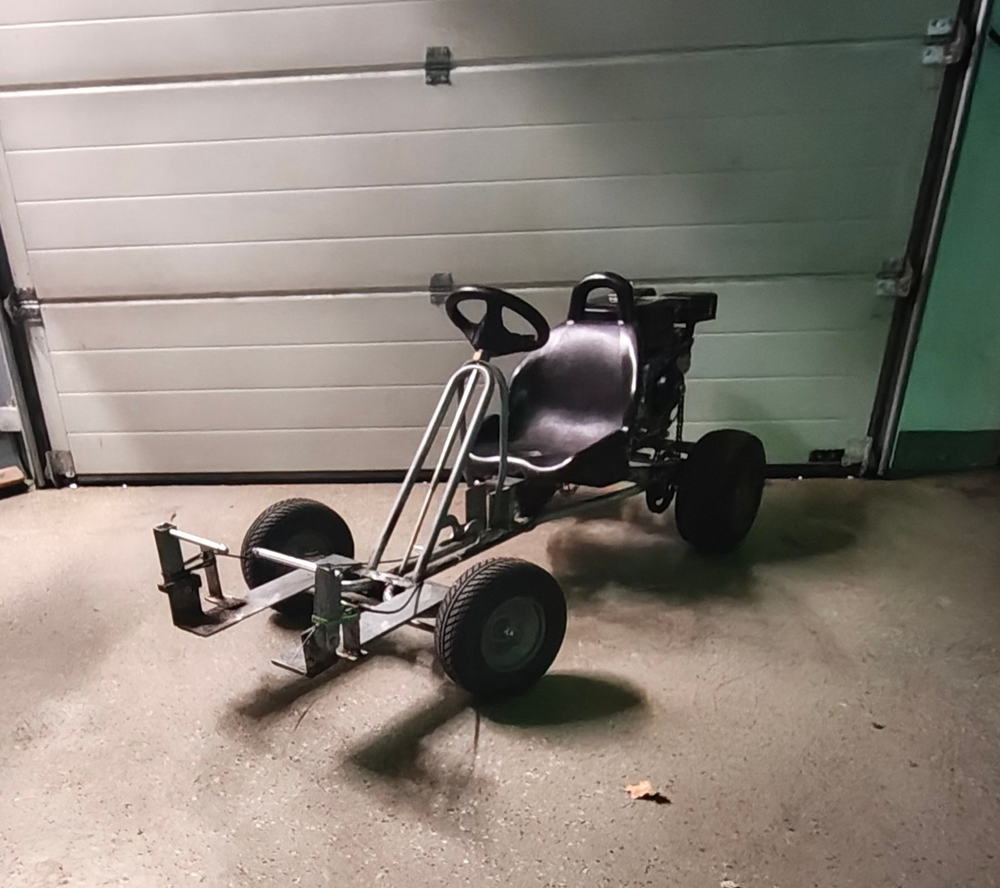

# Budget Go-Kart: Kettcar Frame, 212 cc Engine, €185 in Parts

A hobby build by two friends with one goal: **build a fast kart as cheaply as possible by reusing what was lying around.** The frame and wheels come from an old Kettcar (pedal go-kart), the engine is a 212 cc four-stroke, and the parts that had to be bought new cost about €185 in total. Everything else came from stock. The main parts were ordered in March 2026 and the kart was finished in about six weekends.

## At a Glance

| | |
|---|---|
| **Goal** | Fast kart on a minimal budget, reusing existing material |
| **Cost** | About €185 for purchased parts, everything else from stock |
| **Team** | 2 people |
| **Build time** | About six weekends |
| **Frame and wheels** | Reused Kettcar chassis with original wheels |
| **Engine** | 212 cc, 7.5 hp, four-stroke single-cylinder OHV |
| **Drive** | Centrifugal clutch (10 T) → 420 chain → 38 T rear sprocket, 38 / 10 = 3.8 : 1 |
| **Rear axle** | Two UCP204 pillow block bearings |
| **Brake** | Bicycle disc brake on the rear axle, self-built brake pedal |
| **Wheelbase / track** | 65 cm / 57 cm rear, 56 cm front |
| **Top speed** | Approx. 70 km/h, GPS reading, not logged |
| **Status** | Finished and running |

## Key Engineering Problem and Fix

The rear axle originally ran directly in the Kettcar frame. During the first test runs it wore into the frame material, because a Kettcar frame is designed for pedal power, not engine loads. The fix was **two UCP204 pillow block bearings** bolted to the frame at the rear, so the axle is now carried by proper bearings instead of the frame. After that change the kart ran without problems. Details: [docs/problems-and-solutions.md](docs/problems-and-solutions.md).

Three adapters were turned on a lathe from blanks that were already available. They connect the sprocket, the brake disc and the driven wheel to the axle.

## Cost Summary

| Category | Cost (€) |
|---|---:|
| Purchased new (engine, clutch, chain, sprocket, bearings, bushings, shaft collars) | 185.20 |
| From stock (frame, wheels, steel and aluminium stock, cables, brake, fasteners) | 0.00 |
| **Total** | **185.20** |

Full list: [docs/bill-of-materials.md](docs/bill-of-materials.md).

## Documentation

| Document | Content |
|---|---|
| [docs/specifications.md](docs/specifications.md) | Technical data and drivetrain ratio |
| [docs/build-log.md](docs/build-log.md) | How the kart was built, step by step |
| [docs/problems-and-solutions.md](docs/problems-and-solutions.md) | The rear axle problem: cause and fix |
| [docs/bill-of-materials.md](docs/bill-of-materials.md) | Parts, sources and cost |
| [images/](images/README.md) | Photo index |

Planned: chain guard.

This is a personal hobby project. The kart is not registered or road-legal and is not intended for public roads.

## Author

Built by Simon Kreer together with a friend. Other projects of mine include an industrial-component 3D printer and an ESP32 universal remote; see my [GitHub profile](https://github.com/SimonKreer).

## License

[MIT](LICENSE)
