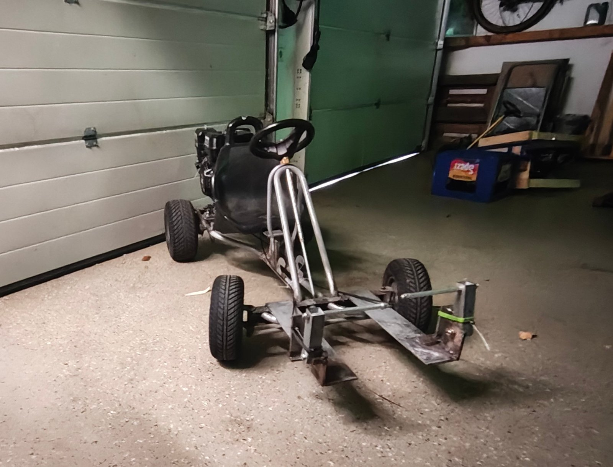
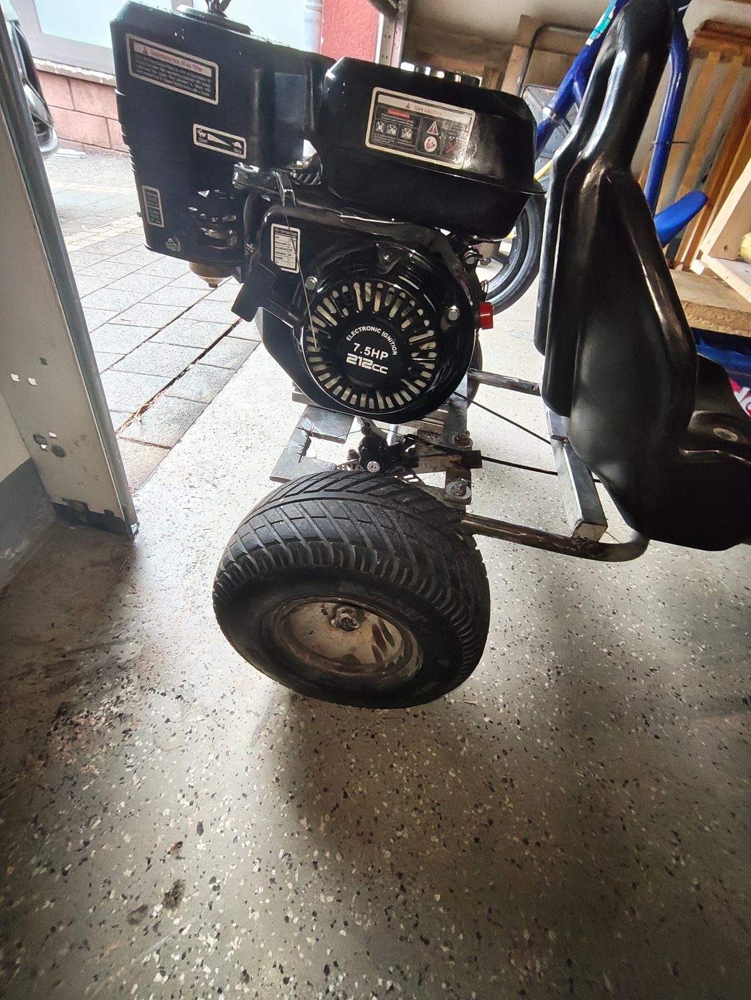
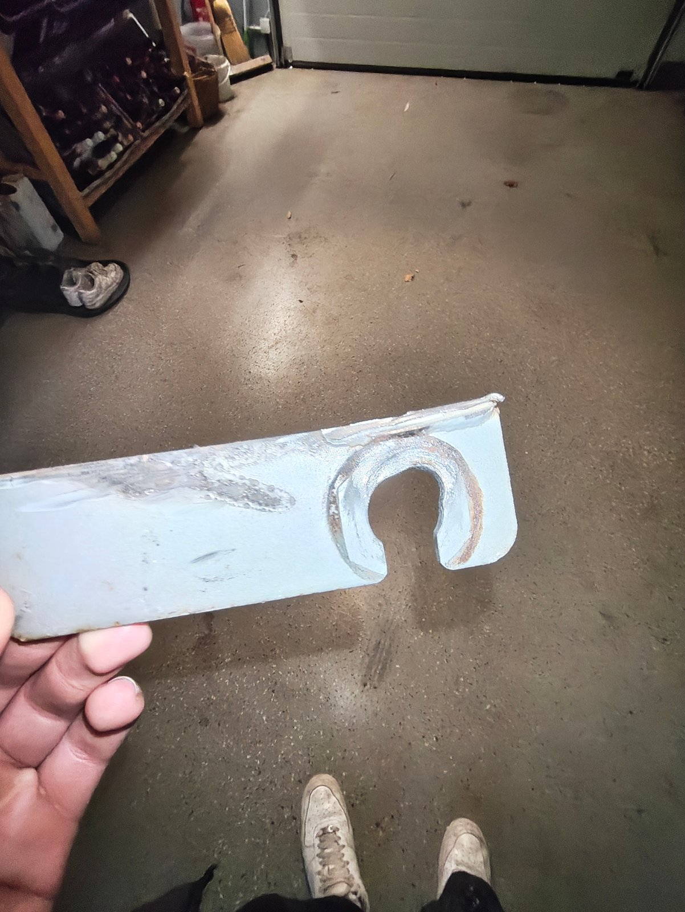
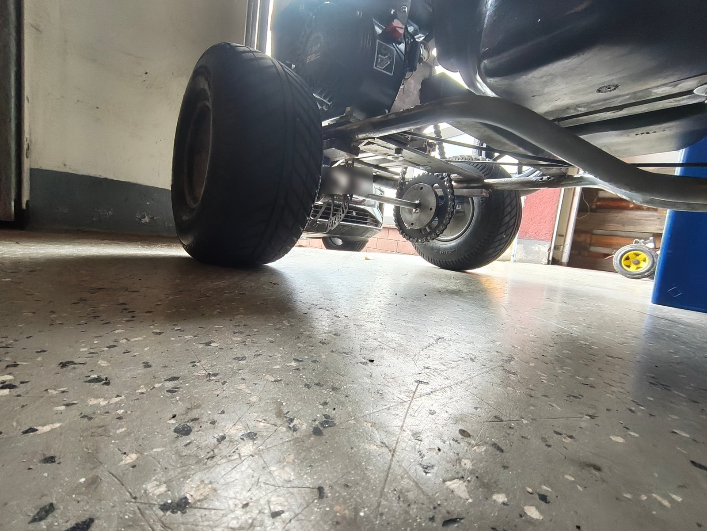

# Build Log

The kart was built by two people in about six weekends. The main parts were ordered in March 2026.

## 1. Concept

Instead of buying a kart frame, the build started from an old Kettcar frame with its original wheels that was already available. The goal was a fast kart built as cheaply as possible, so everything that could be reused was reused. Only the drivetrain parts and bearings were bought new (see [bill-of-materials.md](bill-of-materials.md)).

## 2. Parts Ordered (March 2026)

Engine, centrifugal clutch, chain and rear sprocket were ordered online. Everything else came from stock: flat steel, square tube, aluminium profile, cables, a bicycle disc brake, fasteners and round blanks for the adapters.

## 3. Frame and Engine Mount

The Kettcar frame was extended with flat steel, square tube and aluminium profile from stock to carry the engine at the rear, behind the seat.

## 4. Drivetrain

The 212 cc engine drives the rear axle through a 10-tooth centrifugal clutch, a 420 chain with 108 links and a 38-tooth rear sprocket, giving a reduction of 38 / 10 = 3.8 : 1. Three adapters were turned on a lathe from existing blanks to connect the sprocket, the brake disc and the driven wheel to the axle.

## 5. Controls and Steering

- **Throttle:** self-built throttle pedal with throttle cable.
- **Brake:** bicycle disc brake acting on the rear axle, operated by a self-built brake pedal via brake cable.
- **Steering:** the original Kettcar steering was kept, the play was removed and the steering was moved slightly forward.

## 6. First Test and Axle Failure

With the kart fully assembled, the rear axle still ran directly in the Kettcar frame. During the first test runs the axle wore into the frame. The cause and fix are documented in [problems-and-solutions.md](problems-and-solutions.md).

## 7. Pillow Block Bearings

Two UCP204 pillow block bearings were bolted to the frame at the rear, so the axle is now carried by bearings instead of the frame. After this change the kart ran without problems. Top speed in a test run: approx. 70 km/h, GPS reading, not logged.

## 8. Next Step

Planned: chain guard.
