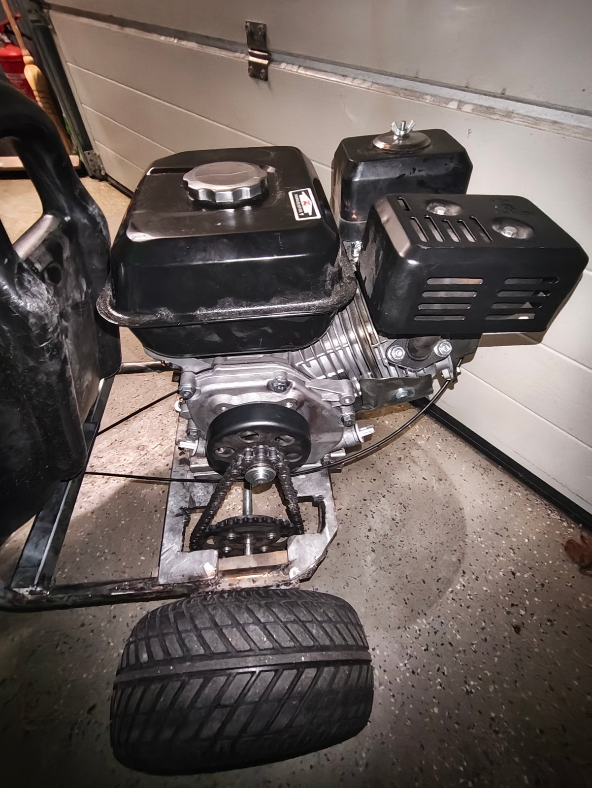
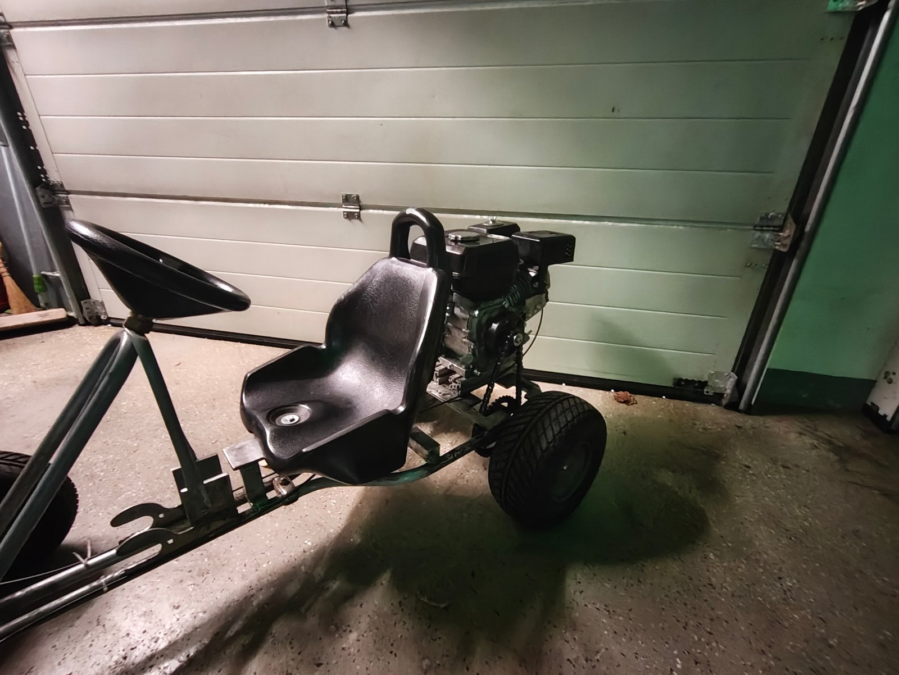

# Specifications

## Powertrain

| Item | Value |
|---|---|
| Engine | 212 cc, 7.5 hp, four-stroke single-cylinder OHV |
| Fuel tank | Supplied with the engine |
| Clutch | Centrifugal clutch, 10 teeth, 420 chain, 20 mm bore |
| Chain | 420, 108 links |
| Rear sprocket | 38 teeth, 420 |
| Overall reduction | 38 / 10 = **3.8 : 1** |
| Throttle | Self-built throttle pedal with throttle cable |

The reduction ratio is the number of teeth on the driven sprocket divided by the number on the drive sprocket:

```
i = z_rear / z_clutch = 38 / 10 = 3.8
```



## Chassis

| Item | Value |
|---|---|
| Frame | Reused Kettcar frame, extended with flat steel, square tube and aluminium profile |
| Wheels | Original Kettcar wheels |
| Wheelbase | 65 cm |
| Track width | 57 cm rear, 56 cm front (narrow because of the Kettcar chassis) |
| Rear axle support | 2 × UCP204 pillow block bearings (20 mm bore, cast housings with grease nipples), bolted to the frame |
| Axle adapters | 3 lathe-turned adapters: sprocket to axle, brake disc to axle, driven wheel to axle |
| Brake | Bicycle disc brake acting on the rear axle, operated by a self-built brake pedal via brake cable |
| Steering | Original Kettcar steering, modified: play removed, steering moved slightly forward |



## Performance

| Item | Value |
|---|---|
| Top speed | Approx. 70 km/h, GPS reading, not logged |
